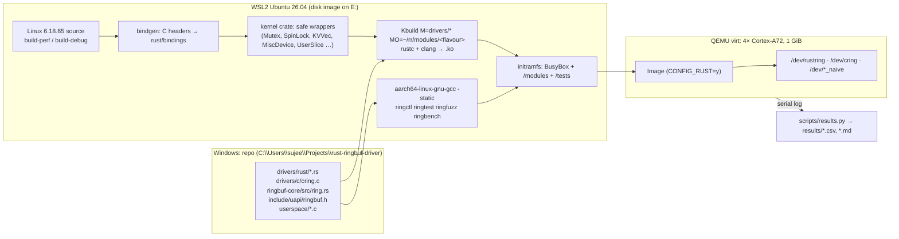

# Architecture

How the pieces of this project fit together, from the source tree down to the
instructions that run on the emulated board.

## 1. Build and run pipeline



Two kernels are built from the same source:

| Flavour | Purpose | Extra options |
|---|---|---|
| `perf` | benchmarks, binary sizes, crash matrix | none (no debug info) |
| `debug` | catch bugs at run time | KASAN, PROVE_LOCKING (lockdep), DEBUG_ATOMIC_SLEEP, DEBUG_KMEMLEAK, DWARF |

## 2. Layers inside `rustring.ko`

```
 user space   read()/write()                         ioctl(GET_STATS | CLEAR | RESIZE | PEEK)
 ───────────────────────┬───────────────────────────────────────┬───────────────────────────
 kernel C     VFS → misc device → file_operations (generated by the kernel crate's MiscDevice vtable)
 ───────────────────────┼───────────────────────────────────────┼───────────────────────────
 kernel crate  Kiocb / IovIterDest / IovIterSource       UserSlice (copy_from_user / copy_to_user)
 (safe API)    Mutex<T> / SpinLock<T> guards (RAII)      KVVec<u8> (kvmalloc/kvfree, fallible, Drop)
 ───────────────────────┼───────────────────────────────────────┼───────────────────────────
 driver.rs     do_read / do_write                        get_stats / clear / resize / peek
               RingError → errno (EAGAIN, EINVAL, EBUSY)  user values: try_from, never `as`
 ───────────────────────┼───────────────────────────────────────┼───────────────────────────
 ring.rs       RingBuf<S>: readable / writable_mut / commit / consume / peek_slices
 (no_std)      forbid(unsafe_code); deny(indexing_slicing, arithmetic_side_effects, unwrap…)
```

`ring.rs` knows nothing about the kernel. Every range and overflow check lives
there, so the same code is property-tested on the host (`cargo test`) and
compiled into the module (`#[path = "../../ringbuf-core/src/ring.rs"] mod ring;`).

## 3. Data structure

```
storage (capacity C bytes, KVVec<u8>)
 ┌──────────────────────────────────────────────────────────────┐
 │ ░░░░░ data ░░░░░ │ free ............................ │ ░ data │
 └──────────────────────────────────────────────────────────────┘
   0                tail = (head+len) % C              head     C
```

* `head` = index of the oldest byte, `len` = bytes stored. Full (`len == C`)
  and empty (`len == 0`) are never ambiguous, and no slot is wasted.
* Data and free space are each at most **two** contiguous slices. `read`
  copies the readable slices straight into the user's iov_iter; `write`
  copies straight from the iov_iter into the writable slices — no bounce
  buffer, no per-call allocation.
* When the ring drains, `head` resets to 0 so the next data is contiguous.

## 4. Locking and lifetime

| Object | Protection | Why |
|---|---|---|
| ring (`RingState`) | global `Mutex` | `copy_to_user`/`copy_from_user` can fault and **sleep**; a spinlock here is the "sleep in atomic context" protocol bug (`rustring_atomic.ko` demonstrates it) |
| counters (`Stats`) | global `SpinLock` | tiny, never sleeps; never taken while acquiring the mutex |
| buffer memory | `KVVec<u8>` inside the mutex | freed by `Drop` on resize and on module exit |
| `/dev/rustring` | `MiscDeviceRegistration` owned by the module struct | deregistered by `Drop` on `rmmod` |

The data lives *inside* each lock, so it can only be reached through the guard
returned by `lock()`, and the guard unlocks in its `Drop` on every return path.

The globals are created with `kernel::sync::global_lock!`, whose one-time
initialisation is the driver's only `unsafe` block (with a `// SAFETY:`
justification). The ring is an `Option`: `None` before init and after exit, so
a late caller gets `-ENODEV` rather than a use-after-free.

## 5. Module variants

| Module | Built from | Difference |
|---|---|---|
| `rustring.ko` | `driver.rs` | the deliverable |
| `rustring_naive.ko` | `driver.rs --cfg naive` | PEEK/RESIZE ported from unchecked C: `buf[a..b]`, `+`, `%`, `.unwrap()` |
| `rustring_atomic.ko` | `driver.rs --cfg atomic_bug` | ring under a `SpinLock` (positive control for DEBUG_ATOMIC_SLEEP) |
| `cring.ko` | `cring.c` | same algorithm, locks and ABI in careful C |
| `cring_naive.ko` | `cring.c -DCRING_NAIVE` | PEEK range check and RESIZE bounds/busy checks removed |
| `rr_hello.ko` | `rr_hello.rs` | Phase 1 toolchain check |
| `rr_leak.ko` | `rr_leak.rs` | leaks 4 KiB in safe Rust (positive control for kmemleak) |

## 6. Test harness

The board's `/init` reads `rr.run=<script>` and `rr.args=a,b` from the kernel
command line, runs `/tests/<script>`, prints `RR-RESULT: … exit=N` and powers
off. The host scripts boot one VM per test (or per crash-matrix cell, three
at a time), capture the serial console and parse it with `scripts/results.py`.
