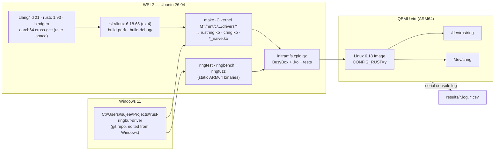

# Implementation Plan — Panic-Resilient Ring-Buffer Driver in Safe Rust

Project: *Securing Embedded Linux Device Drivers: A Safe Rust Framework and Protocol
Invariant Implementation* (ECE Mini Project 2026–27, Gaurav Gupta & Sujeet Venkata Raman).

This document turns the synopsis into a concrete build. Each objective in the synopsis
maps to a phase below with a deliverable you can show at the review.

---

## 1. What we are building (one paragraph)

A Linux **character device driver** (`/dev/rustring`) written in **safe Rust** against the
Linux **6.18 LTS** kernel's built-in Rust support. It manages a **circular ring buffer**
in kernel memory: user programs `write()` bytes in and `read()` them out (FIFO), and
use `ioctl()` to get statistics, clear, resize, and *peek* at an arbitrary offset. An
**equivalent C driver** (`/dev/cring`) exposes the identical interface. Both run inside an
**emulated ARM64 board (QEMU `virt`)** booted from WSL. A user-space C test suite attacks
both drivers with invalid offsets, overflowing sizes, bad pointers and concurrent access,
and a benchmark tool measures throughput. We then compare **binary footprint, I/O
bandwidth, and crash resilience** — the three metrics the synopsis promises.

---

## 2. Platform decisions

| Decision | Choice | Why |
|---|---|---|
| Host Linux | **Existing WSL2 distro `Ubuntu` = Ubuntu 26.04 LTS** | Current LTS. The kernel's own Rust docs say Ubuntu ≥ 25.04 works "out of the box" with plain `apt install rustc rust-src bindgen …`; 24.04 needs versioned packages + manual symlinks. It is also nearly empty (no compilers yet), so nothing will conflict. |
| Target kernel | **Linux 6.18.65 (longterm)** from kernel.org | Newest LTS (synopsis asks for "6.6+ LTS"). 6.18 is the first LTS where the Rust `miscdevice` API has `read_iter`/`write_iter`/`ioctl` — exactly what a character driver needs. LTS = APIs won't move under us. (Mainline is 7.4-rc, too unstable for a semester project.) |
| Target board | **QEMU `virt`, ARM64 (Cortex-A57), TCG emulation** | Synopsis: "emulated ARM64 board". Cross-compiling for ARM64 is the realistic embedded workflow. |
| Compiler | **LLVM/Clang 21 (`LLVM=1`)** + **rustc 1.93 (apt)** + **bindgen (apt)** | Synopsis: LLVM/Clang. Rust-for-Linux requires an LLVM-based C compiler so C and Rust objects agree on ABI. `make rustavailable` verifies the combination before we build. Fallback: pin a different Rust via `rustup` if 1.93 is rejected. |
| Why not load into WSL's own kernel? | — | WSL runs Microsoft's kernel without `CONFIG_RUST`, and a buggy module (our *naive* variants are buggy on purpose) would crash your whole WSL. In QEMU a crash just ends one VM run — that's what makes crash-resilience testing safe and repeatable. |
| Root filesystem | **BusyBox initramfs** (static, ARM64) | Tiny (≈2 MB), boots in seconds, contains only a shell + our modules + test binaries. No disk image to manage. |
| Kernel builds | **Two configs from one source tree** | `perf`: clean kernel for benchmarks. `debug`: KASAN (memory-error detector), lockdep (lock-order checker), DEBUG_ATOMIC_SLEEP ("sleeping in atomic context" detector), kmemleak (leak detector). Debug options slow the kernel 2–5×, so benchmarking on it would be unfair. |

Optional stretch: an **x86_64 guest with KVM** (your WSL exposes `/dev/kvm`) for
near-native benchmark numbers. Costs a third kernel build (~15 min, ~3 GB). Decide later.

---

## 3. Architecture



Kernel sources and build output live on WSL's ext4 disk (the kernel tree has file names
that differ only in case, which breaks on NTFS, and NTFS via `/mnt/c` is ~10× slower).
**Our** source code stays in this Windows folder so you can edit it with any Windows
editor and push it from Windows; WSL builds it through `/mnt/c/...`.

### Driver internals

```
 user space          read()/write()                    ioctl(GET_STATS|CLEAR|RESIZE|PEEK)
──────────────────────────┬───────────────────────────────────────┬──────────────────────
 kernel (rustring.ko)     ▼                                       ▼
   MiscDevice impl ── maps RingError → errno (EAGAIN/EINVAL/EFAULT/ENOMEM/ENOTTY)
        │  lock()  (RAII guard: unlocked automatically on every return path)
        ▼
   Mutex<RingState> ──► ringbuf-core::RingBuf<KVVec<u8>>   (pure safe Rust, no kernel deps)
   SpinLock<Stats>  ──► counters (bytes in/out, rejected ops)
        │
   Drop for module ──► storage freed, misc device deregistered — no manual cleanup code
```

The **ring-buffer logic is a separate `no_std` crate** (`ringbuf-core/`) that depends only
on `core`. The kernel module includes it with `#[path]`, and the *same file* is unit- and
property-tested on the host with `cargo test` (thousands of random operation sequences
compared against a reference `VecDeque`). Kernel bugs are expensive to debug; logic bugs
caught on the host are cheap.

---

## 4. Driver specification (shared by Rust and C versions)

| Operation | Behaviour |
|---|---|
| `write(buf, n)` | Copies `min(n, free)` bytes in, returns count. Ring full → `-EAGAIN`. No overwrite of unread data (lossless FIFO). |
| `read(buf, n)` | Copies `min(n, used)` bytes out, returns count. Empty → `0` (so `cat /dev/rustring` drains and exits). |
| `RB_IOC_GET_STATS` | Returns `{capacity, used, bytes_written, bytes_read, rejected_ops}`. |
| `RB_IOC_CLEAR` | Discards all data. |
| `RB_IOC_RESIZE(u64 cap)` | `cap` outside `[64 B, 4 MiB]` → `-EINVAL`; data present → `-EBUSY`; allocation failure → `-ENOMEM` (fallible allocation, never a crash). |
| `RB_IOC_PEEK{offset,len,ptr}` | Copies `len` bytes starting `offset` bytes past the read position, without consuming. `offset+len` overflow or `> used` → `-EINVAL`; bad `ptr` → `-EFAULT`. **This is the attack surface** — user-controlled offset and length, the classic source of driver CVEs. |
| unknown ioctl | `-ENOTTY` |

The ABI lives in one header, `include/uapi/ringbuf.h`, used by the C driver and the tests;
the Rust driver mirrors the constants (a test checks they match).

The buffer is shared by everyone who opens the device (pipe-like), so a producer and a
consumer process can talk through it — this is what gives us real concurrency to test.

---

## 5. How each synopsis requirement is enforced

| Synopsis rule | Mechanism in this project | How it is *verified*, not just claimed |
|---|---|---|
| (a) No `buf[i]` — use `.get()` → `Result` | `ringbuf-core` uses `.get()/.get_mut()` and slice splitting only | `#![deny(clippy::indexing_slicing)]`; build with `make CLIPPY=1` fails on any `buf[i]` |
| (b) Checked arithmetic → `-EINVAL` | `checked_add` / `checked_sub` / `checked_mul` on every user-derived value | `#![deny(clippy::arithmetic_side_effects)]` |
| No panics on bad input | No `unwrap`/`expect`/`panic!` | `#![deny(clippy::unwrap_used, clippy::expect_used, clippy::panic)]` + fuzz test |
| (c) Data only reachable through a lock; lock always released | `Mutex<RingState>` / `SpinLock<Stats>`; the guard is the *only* way to reach the data and unlocks in its `Drop` | Compiler enforces access; lockdep in the debug kernel checks ordering under stress |
| Drop-based cleanup | Module struct owns the misc-device registration; storage is a `KVVec` (kmalloc/vmalloc wrapper that frees in `Drop`) | 100× load/unload cycles + `kmemleak` scan = 0 leaks |
| Minimal, audited `unsafe` | Driver needs **exactly one** `unsafe` line (initialising the global lock, required by the 6.18 API), with a `// SAFETY:` justification | `#![deny(clippy::undocumented_unsafe_blocks)]` + a grep-based audit counted in the report |

**Design note — why a `Mutex` and not a `SpinLock` for the ring data.** Copying to/from user
memory (`copy_to_user`) can page-fault and *sleep*. Sleeping while holding a spinlock is
precisely the "sleep-capable call in atomic context" protocol bug the synopsis lists as
something the Rust compiler *cannot* detect. So the ring data uses a sleepable `Mutex<T>`,
and the short, non-sleeping statistics update uses a `SpinLock<T>`. The debug kernel's
`CONFIG_DEBUG_ATOMIC_SLEEP` would flag the wrong choice at runtime. This is a good viva
talking point: Rust removes memory bugs, but *protocol* rules still need design + tooling.

**Note on bindgen / kmalloc wrappers.** The 2019 ARES paper hand-wrote bindgen bindings and
a `GlobalAlloc` over `kmalloc`. In Linux 6.x this is built in: the kernel build runs bindgen
over the C headers (`rust/bindings/`) and provides `KBox`/`KVec`/`KVVec` as safe, fallible,
`Drop`-freeing wrappers over `kmalloc`/`kvmalloc`. We use those rather than re-inventing them
(out-of-tree modules can't replace them anyway), and the report shows where the generated
bindings and the wrappers live.

---

## 6. The comparison experiment

Four modules, same interface, built from two source files:

| Module | Language | Input validation | Purpose |
|---|---|---|---|
| `rustring.ko` | Rust | Defensive ("Yes+P" rules, lint-enforced) | **The deliverable** |
| `cring.ko` | C | Careful, hand-written checks | Fair baseline for size & speed |
| `rustring_naive.ko` | Rust | Plain `buf[i]`, `a + b`, `.unwrap()` | Shows problem #2: memory-*safe* but **panics → kernel oops / DoS** |
| `cring_naive.ko` | C | Missing bounds/overflow check in PEEK | Shows the classic C bug: **silent out-of-bounds read** (KASAN catches it) |

The naive variants are compile-time switches on the same source (`--cfg naive` /
`-DCRING_NAIVE`), so the *only* difference is the validation code.

**Metrics**

1. **Binary footprint** — `llvm-size` (text/data/bss) of each stripped `.ko`, and the
   in-kernel size from `/proc/modules`.
2. **I/O bandwidth** — `ringbench`: write+read loops at 16 B … 4 KiB chunk sizes, 10
   runs each, alternating Rust/C runs to cancel drift; mean ± std-dev MB/s and ns/op;
   plus a 2-thread producer/consumer run. (Under emulation, absolute numbers are
   low; the *ratio* Rust/C is what matters.)
3. **Crash resilience** — `ringtest` + `ringfuzz`: scenario table (offset past end,
   `offset+len` wrapping `u64`, `len = SIZE_MAX`, resize to 0 / 2⁶⁰, NULL and kernel
   pointers, 100 000 random ioctls, concurrent writers/readers/resizers). Each scenario
   runs in a **fresh VM** booted with `panic_on_oops=1` (as on Android/embedded
   devices) and the outcome is recorded as *clean errno* / *KASAN report* / *oops* /
   *kernel panic*.
4. **Hygiene** (debug kernel) — 0 KASAN reports, 0 lockdep splats, 0 atomic-sleep
   warnings, 0 kmemleak leaks for `rustring.ko` and `cring.ko`.

---

## 7. Repository layout (target)

```
rust-ringbuf-driver/
├── README.md                    quick start + results summary
├── docs/  IMPLEMENTATION_PLAN.md · ARCHITECTURE.md · RESULTS.md · VIVA_NOTES.md
├── env/                         run inside WSL; idempotent
│   ├── versions.env             pinned versions + sha256 of downloads
│   ├── 00-install-packages.sh   apt packages (needs sudo)
│   ├── 01-fetch-sources.sh      kernel + BusyBox tarballs, checksum-verified
│   ├── 02-build-kernel.sh       perf | debug
│   ├── 03-build-busybox.sh
│   └── kconfig/ rust.config · perf.config · debug.config
├── include/uapi/ringbuf.h       shared ioctl ABI
├── ringbuf-core/                no_std ring buffer + host tests (cargo test)
├── drivers/
│   ├── rust/        rustring.rs, Kbuild        (+ naive build dir)
│   └── c/           cring.c, Kbuild            (+ naive build)
├── userspace/       ringtest.c · ringbench.c · ringfuzz.c · Makefile
├── qemu/            init · mkinitramfs.sh · run.sh (--debug --gdb --auto)
├── scripts/         build-all.sh · test-all.sh · bench.sh · sizes.sh · audit-unsafe.sh
└── results/         committed CSVs + summarised logs
```

---

## 8. Phases

Each phase ends with a git commit and a short demo you can reproduce with one script.

| # | Phase | Synopsis step | Deliverable / exit criterion |
|---|---|---|---|
| 0 | **Environment** | 1 | Packages installed; `make LLVM=1 rustavailable` prints "Rust is available!" |
| 1 | **Kernel + emulated board** | 1 | 6.18.65 `perf` and `debug` ARM64 kernels with `CONFIG_RUST=y`; BusyBox initramfs; QEMU boots to a shell; a hello-world *out-of-tree* Rust module loads (`insmod`) and unloads — proves the Cargo↔Kbuild pipeline end-to-end |
| 2 | **Safe ring-buffer core** | 2, 3 | `ringbuf-core` with `cargo test` + property tests passing; Clippy deny-lints clean |
| 3 | **Rust driver** | 3, 4 | `rustring.ko`: misc device, read/write/ioctl, Mutex + SpinLock, Drop cleanup; manual demo in QEMU (`echo hi > /dev/rustring; cat /dev/rustring`) |
| 4 | **C driver + naive variants** | 5 | `cring.ko`, `rustring_naive.ko`, `cring_naive.ko`; same behaviour verified by the same functional tests |
| 5 | **Test suite, fuzzing, benchmarks** | 5 | `ringtest`, `ringfuzz`, `ringbench`; `scripts/test-all.sh` boots VMs unattended and writes `results/*.csv`; debug-kernel hygiene runs |
| 6 | **Results + documentation** | — | `RESULTS.md` tables (size / bandwidth / resilience), `ARCHITECTURE.md`, `VIVA_NOTES.md` (how to explain each design choice), polished README; repo ready for you to push |
| 7 | *(optional)* x86_64 + KVM benchmarks, GDB walkthrough, Semgrep rules | — | Only if you want them |

I'll pause and report to you after Phases 1, 3 and 5 (the points where something visible
works), not after every step.

---

## 9. What I need from you

1. **Approve this plan** (or tell me what to change).
2. **Package install permission.** ~2.5 GB of Ubuntu packages:
   `build-essential clang lld llvm libclang-dev rustc rust-src bindgen rustfmt rust-clippy
   cargo flex bison bc cpio kmod libelf-dev libssl-dev python3 rsync
   gcc-aarch64-linux-gnu libc6-dev-arm64-cross qemu-system-arm gdb-multiarch`.
   I can run this myself via `wsl -d Ubuntu -u root -- apt-get install …` (no password
   prompt needed), or you can run `env/00-install-packages.sh` yourself — your choice.
3. **Download permission** for two source tarballs (checksums verified):
   `linux-6.18.65.tar.xz` from cdn.kernel.org (~150 MB) and `busybox-1.37.0.tar.bz2` from
   busybox.net (~2.5 MB). Host-side property tests also pull the `proptest` crate from
   crates.io (~5 MB) via cargo.
4. **Set your git identity** (needed before the first commit, and for GitHub anyway):
   ```
   git config --global user.name  "Your Name"
   git config --global user.email "you@example.com"
   ```
5. At the end: create the GitHub repo and `git push` (you said you'll do this).

## 10. Resources & risks

**Disk:** ~12 GB will be written inside WSL's virtual disk, which lives on `C:` (you have
~22 GB free). Mitigations: no debug info in the `perf` kernel, modules built only for our
drivers (`mod2noconfig`), tarballs deleted after extraction. After the project,
`wsl --manage Ubuntu --set-sparse true` lets Windows reclaim freed space.

**Time:** Each kernel build ≈ 15–25 min on your Ryzen 5 7600X (12 threads, 7 GB RAM
visible to WSL). Everything else is minutes.

| Risk | Mitigation |
|---|---|
| rustc 1.93 / clang 21 rejected or warning-heavy on 6.18 | `make rustavailable` checks first; fall back to a `rustup`-pinned Rust |
| Out of memory during the Rust-heavy part of the kernel build | Build with `-j8`; WSL already has swap; optional `.wslconfig` `memory=10GB` |
| ARM64 emulation makes benchmarks slow | Report ratios; optional x86_64 + KVM run for absolute numbers |
| 6.18 API gaps (e.g. no Rust module parameters until later kernels) | Capacity is set via `RB_IOC_RESIZE` instead of a module parameter |
| CRLF line endings breaking scripts | `.gitattributes` forces LF |

## 11. Deliberate deviations from the synopsis (and why)

| Synopsis says | We do | Reason |
|---|---|---|
| "Spinlock<T> for shared variables" | `Mutex<T>` for ring data, `SpinLock<T>` for counters | User-copy can sleep; spinlock there would be a protocol bug (see §5) |
| Hand-made bindgen + kmalloc wrappers | Use 6.18's generated `bindings` + `KBox/KVec/KVVec` | Already in the kernel; same idea, maintained upstream |
| "Ubuntu 22.04/24.04" | Ubuntu 26.04 LTS | Already installed; newer LTS; officially simpler for Rust kernel builds |
| "interrupt line release" in Drop | Not applicable | A virtual char device has no IRQ; Drop handles device deregistration + memory, which is the same mechanism |
| Character **or** Ethernet driver | Character (misc) driver | The synopsis offers either; char driver keeps the focus on the safety rules |
